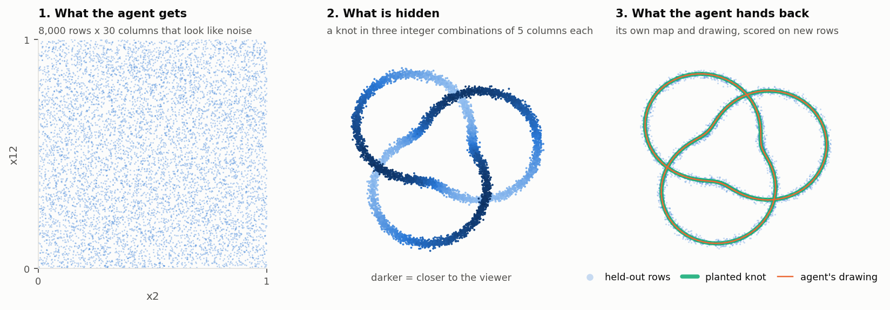
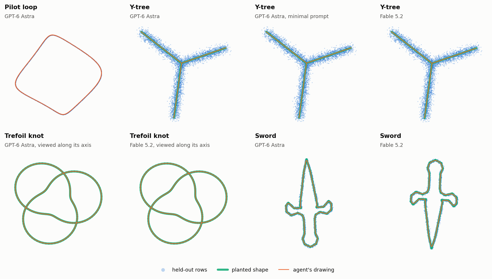
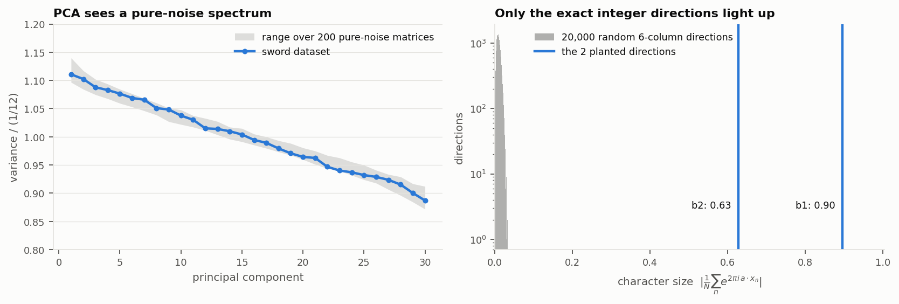
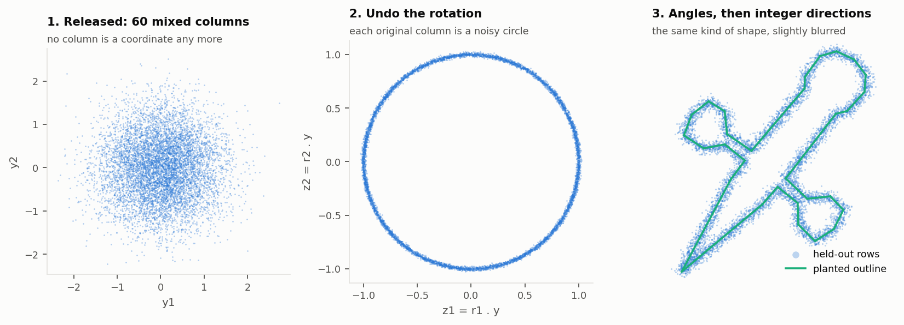
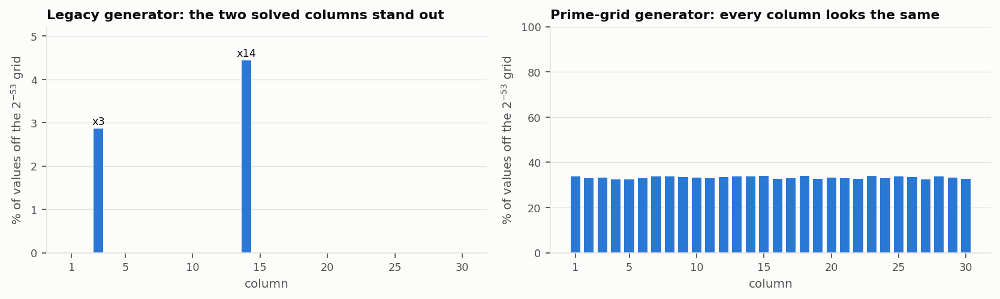

# Agents SEEK Patterns

**Can an AI agent find a drawing hidden in a table of numbers that every
standard statistical test calls noise?**

This repo is a method for building such tables, a benchmark for scoring what
an agent finds in them, and the record of what two frontier agents did with
four of them.



The two halves have names:

| | Stands for | What it is |
|---|---|---|
| **BLEND** | **B**uried **L**atent **E**ncoding in **N**early-independent **D**istributions | The generator. It takes any shape (a knot, a tree, a sword) and buries it in a few secret integer combinations of the columns. Every single column, every pair, every small group of columns is provably indistinguishable from independent random numbers. |
| **SEEK** | **S**tructures **E**mbedded in **E**xact **K**-wise-independent data | The benchmark. The agent gets one CSV and no hints. It must decide whether anything is there, write down a formula that exposes it, and draw what it sees. It is scored on rows it never saw. |

Why this is a good test of an agent:

- **No shortcut through the usual toolbox.** Histograms, correlations, PCA
  and any test that looks at only a few columns at a time return "noise".
  That is a theorem, not a tuning choice.
- **The answer is unmistakable once found.** The right formula turns static
  into a clean picture, so success is not a matter of interpretation.
- **Difficulty is a dial.** Number of columns, columns per hidden direction,
  noise and an optional second disguise layer each make the search harder in
  a known way.
- **It rewards method, not recall.** The agent has to form hypotheses about
  how structure could hide, build its own search, and know when to stop.

In the first nine runs the agents solved eight, and one of them won by
finding a flaw in our generator that we had not noticed.

## Results so far

Four datasets, two agents, nine runs. Score is the grader output on 5,000
held-out rows (1.0 is perfect). "Lattice" means the agent's integer directions
span exactly the planted ones.

| Dataset | Agent | Prompt | Score | Lattice | How it got there (from its own log) |
|---|---|---|---|---|---|
| Pilot loop, 4,000 x 50 | GPT-6 Astra (medium) | standard | 0.953 ¹ | exact | Fourier search over sparse integer directions |
| Pilot loop, 4,000 x 50 | Claude Fable 5.2 | not archived ² | **0** | none | 16 tests, all matched noise; answered "none" |
| Y-tree, 5,000 x 30 | GPT-6 Astra (medium) | standard | 0.988 | exact | Fourier search |
| Y-tree, 5,000 x 30 | GPT-6 Astra (medium) | minimal | 0.988 | exact | Fourier search |
| Y-tree, 5,000 x 30 | Claude Fable 5.2 | standard | 0.988 | exact | Fourier search |
| Trefoil knot, 8,000 x 30 | GPT-6 Astra (medium) | standard | 0.992 | exact | Fourier search |
| Trefoil knot, 8,000 x 30 | Claude Fable 5.2 | standard | 0.992 | exact | tried lattice reduction, then a GPU Fourier scan |
| Sword, 8,000 x 30 | GPT-6 Astra (medium) | standard | 0.947 | exact | Fourier search |
| Sword, 8,000 x 30 | Claude Fable 5.2 | standard | 0.947 | exact | floating-point side channel (see below) |

¹ The pilot has no held-out rows in this repo; this score is from the original chat evaluation on freshly generated rows.
² That run was given the file as `example_X.csv` and wrote no `submission.json`; its `LOG.md` lists what its tests could not rule out.

The scores for the other three datasets are recomputed by
`results/grade_runs.py` and match the original chat evaluations
(`runs/*/*/eval.md`) to four digits. Full table: [`results/results.csv`](results/results.csv).



Two things we did not plan for:

- **An agent broke the generator, not the math.** On the sword, Fable noticed
  that 28 columns were exact multiples of 2⁻⁵³ and two were not. Those two
  were the columns the generator had *computed* rather than drawn. That
  shortcut is what the current generator removes ([details](#the-floating-point-leak)).
- **The one miss was the widest dataset.** The pilot has 50 columns and 6
  columns per direction, the largest search space of the four. This is one
  run, so it says little about the model.

## How BLEND hides a shape

This section is the short version. The full treatment, with proofs of the
concealment and Fourier-support theorems, recovery methods and what is and
is not proved, is in [`docs/math.md`](docs/math.md).

1. Draw a shape and sample points $u_n \in [0,1)^k$ on it ($k$ = 2 or 3).
2. Pick a secret integer matrix $B \in \mathbb{Z}^{k \times D}$ whose rows touch only a few of the $D$ columns.
3. For every row, fill $D-k$ columns with uniform random numbers and solve the remaining $k$ so that

$$B\,x_n \bmod 1 = u_n .$$

4. Release only $X$.

A toy version with five columns:

$$u = (x_1 + x_3 + x_4 + x_5) \bmod 1, \qquad v = (x_2 + x_3 - x_4 + 2x_5) \bmod 1 .$$

### Why it looks random

Let $\delta$ be the smallest number of columns touched by any nonzero vector
in the row space of $B$. Then **any $\delta - 1$ columns of $X$ are exactly
independent and uniform**, whatever the shape is. For the trefoil above
$\delta = 5$: every histogram, every pair, every triple, every 4-column
statistic has the same distribution as pure noise (for the sword,
$\delta = 6$). PCA and correlations see nothing.

### Why it can still be found

A Fourier character $\frac{1}{N}\sum_n e^{2\pi i\, a \cdot x_n}$ with integer
$a$ averages to zero unless $a$ lies in the row lattice of $B$. On that
lattice it equals a Fourier coefficient of the shape, which is large for a
thin curve. So the structure is a needle: invisible in every direction except
a handful of exact integer ones.



### Basic and full BLEND

| | Basic | Full |
|---|---|---|
| Released | $X \in [0,1)^{N \times D}$ | $Y \in \mathbb{R}^{N \times 2D}$ |
| Encoding | $Bx \bmod 1 = u$ | the same, then $y = R\,\phi(x) + \eta$ |
| To solve it | find the integer directions $B$ | first recover the circle coordinates, then $B$ |
| Config | `"encoding": "basic"` | `"encoding": "full"` |
| Tested on agents | yes (legacy generator) | **not yet** |

In the full version each column becomes a point on a circle,
$\phi(x) = (\cos 2\pi x_1, \sin 2\pi x_1, \dots, \cos 2\pi x_D, \sin 2\pi x_D)$,
all $2D$ numbers are mixed by a secret rotation $R$, and Gaussian noise
$\eta$ is added. Every polynomial statistic of $Y$ of degree below $\delta$
still matches the null exactly, because such a statistic involves fewer than
$\delta$ of the original columns.

The null for full BLEND is uniform data pushed through the same $R$ and noise.
It is not featureless (it still lives on circles), so finding the circles
alone scores zero; the agent has to find what distinguishes planted from null.



### The floating-point leak

The legacy generators drew free columns from the random number generator and
computed the pivot columns in floating point. Generator output is always a
multiple of 2⁻⁵³; computed values often are not. All four tested datasets
carry this fingerprint.

`blend/generate.py` samples every value on one shared prime grid
($p = 1{,}000{,}000{,}007$) and solves the pivots exactly in $\mathbb{F}_p$,
so all columns have the same numeric format.



## How SEEK scores

The agent gets `X.csv` and [`seek/prompt.txt`](seek/prompt.txt), and writes a
`submission.json` with:

- `status`: `"structure"` or `"none"`,
- `map`: 1 to 3 short expressions that turn a row into coordinates,
- `drawing`: up to 200 points with segments and triangles,
- `report`: what it found, in plain language.

The grader applies the map to held-out planted rows and to null rows:

$$\text{score} = \max(0,\ \text{hit}_\text{planted} - \text{hit}_\text{null}) \times \text{drawing precision}$$

- **hit**: share of rows within ε = 0.055 of the drawing, after dividing each
  map output by its standard deviation on null rows;
- **drawing precision**: share of the drawing that has planted rows nearby,
  so a drawing that covers everything scores nothing.

The agent chooses its own coordinates, so any correct basis of the lattice
works. Lattice recovery is checked separately in `results/grade_runs.py`.

## Quick start

```bash
pip install numpy scipy matplotlib        # or: uv sync

# 1. generate an instance (basic, or the *_full.json configs for full BLEND)
python -m blend.generate --config blend/configs/sword.json --out out/sword

# 2. check that low-order statistics cannot tell it from noise
python -m blend.audit out/sword/agent/X.csv --nulls 39

# 3. give ONLY out/sword/agent/X.csv and seek/prompt.txt to an agent, then grade
python -m seek.grade submission.json --private out/sword/private

# re-grade the archived runs and rebuild the figures
python results/grade_runs.py
python results/make_figures.py
```

A config is a few lines of JSON:

```json
{
  "seed": 2026111703,
  "D": 30, "N": 8000, "k": 2,
  "noise_sigma": 0.004,
  "shape": {"kind": "sword"},
  "lattice": {"support_per_direction": 6, "coefficients": [-2, -1, 1, 2],
              "disjoint_supports": true, "min_delta": 6},
  "encoding": "full",
  "disguise": {"rotate": true, "noise_sigma": 0.01}
}
```

Built-in shapes: `sword`, `y_tree`, `x_cross`, `two_loops`, `figure8`,
`random_tree`, `trefoil` (3-D), `random`, and `polyline` for any outline you
supply as vertices and edges (`blend/configs/custom_shape.json`).

`private/reference_submission.json` is an **oracle** built from the answer
key. It shows the instance is gradeable, not that it is solvable blind.

## Repository layout

```
blend/            generate.py (basic + full), audit.py, configs/
  legacy/         the original per-level generators, kept for the record
seek/             grade.py, prompt.txt, prompt_minimal.txt, prompt_full.txt
datasets/         the four tested instances: X.csv.gz + private/ answer keys
runs/             what each agent did: submission, log, scripts, plots, eval.md
results/          results.csv, grade_runs.py, make_figures.py
docs/             math.md (full derivation), explainer.html (visual walkthrough), figures/
```

## Limitations

- **One run per cell.** Nine runs in total; no variance estimates.
- **Tested data is legacy data.** The agents saw datasets from
  `blend/legacy/`. Neither the prime-grid generator nor full BLEND has been
  run against an agent yet. `seek/prompt_full.txt` is a draft.
- **The tested datasets are burned.** Their answer keys are in this repo.
- **No "none" instances.** Every dataset contained structure, so false
  positives on pure noise are unmeasured.
- **No blind reference solver for the new generator.** The legacy scripts
  rejected instances their own solver could not recover; `blend/generate.py`
  only checks the math and that the shape's Fourier coefficients are large.
- **The audit covers five diagnostics.** Statistics of degree $\delta$ and
  higher can detect planted instances, by design and sometimes more easily
  than intended.
- **Shapes are 1-D curves and graphs**, with at most 3 latent dimensions.
- The original evaluations in `runs/*/*/eval.md` were written by a chat
  model; their figures were not saved, and only the grader numbers have been
  reproduced here.
